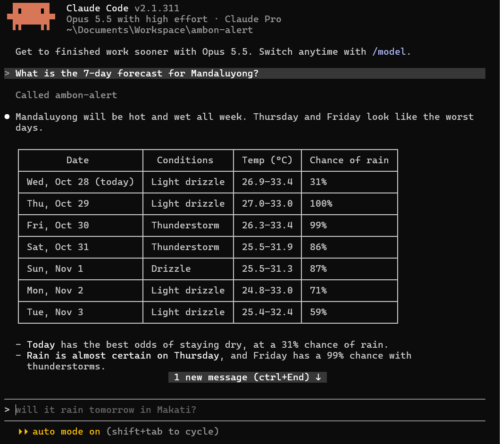

# ☔ Ambon Alert — MCP Server

**Ambon Alert** is an MCP (Model Context Protocol) server that lets AI assistants like Claude check the weather for any city.

*"Ambon"* means drizzle in Filipino, so now your AI can tell you when to bring an umbrella. ☂️



## Features

| Tool | What it does | Example question |
|---|---|---|
| `get_weather` | Current weather: sky, temperature, humidity, wind | "What is the weather in Mandaluyong?" |
| `will_it_rain` | Chance of rain today, with an umbrella tip | "Will it rain in Cebu today?" |
| `get_forecast` | Forecast for the next 1–7 days | "What's the 7-day forecast for Baguio?" |

## Tech stack

- **Python 3.10+**
- **[MCP Python SDK](https://github.com/modelcontextprotocol/python-sdk)** v2 (`MCPServer`)
- **[Open-Meteo API](https://open-meteo.com/)**: free, no API key needed
- Only the Python standard library for HTTP (`urllib`), so there is just one dependency

## Setup

**1. Install the MCP library**
```bash
pip install mcp
```

**2. Connect the server to Claude Code**

From inside the project folder:

```bash
# Windows (CMD)
claude mcp add ambon-alert --scope user -- python "%CD%\ambon_alert_server.py"

# macOS / Linux
claude mcp add ambon-alert --scope user -- python3 "$(pwd)/ambon_alert_server.py"
```

**3. Check the connection**
```bash
claude mcp list
```

**4. Ask Claude about the weather**
```
claude
> What is the weather in Mandaluyong?
```

## How it works

```
You ──ask──▶ Claude ──calls tool──▶ Ambon Alert (MCP server) ──▶ Open-Meteo API
                ◀────── weather answer ◀──────────────────────────────┘
```

1. You ask Claude a weather question.
2. Claude sees the Ambon Alert tools and picks the right one.
3. The server turns the city name into coordinates (Open-Meteo Geocoding API).
4. It gets the weather data and returns a simple, readable answer.

## What I learned

- How MCP connects AI models to outside tools and data
- Writing MCP tools with Python type hints and docstrings
- Working with REST APIs and JSON in Python
- Setting up Claude Code and MCP servers on Windows

## Author

**Janelle Catibog** · BS Information Technology, Mapúa University
[Portfolio](https://janelle-catibog.lovable.app) · [GitHub](https://github.com/jcatibog014)

Weather data by [Open-Meteo.com](https://open-meteo.com/) (CC BY 4.0).
